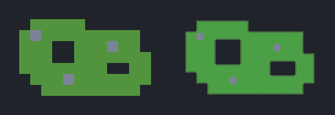

# Aseprite Tilemap Editor

Paint a level in Aseprite, one pixel per cell, and turn it into a Unity prefab with native Tilemaps. Each color picks a terrain brush or a decoration stamp. The live preview resolves terrain edges while you work, and Aseprite layers carry through to Unity.



The same level as a color-coded plan and as a native Tilemap, using the included sample pack.

## Install

- **Aseprite 1.3.18.6 or later** — Download `AsepriteTilemapEditor-1.3.0.aseprite-extension` from [Releases](https://github.com/Ash2oPS/aseprite-tilemap-editor/releases). In Aseprite, go to **Edit → Preferences → Extensions → Add Extension** and select the downloaded file. A sample tileset is included.
- **Unity 6.3 or later with Git installed** — Open **Window → Package Manager → + → Install package from git URL**, then paste the URL below. Keep the version tag so teammates get the same package.

```text
https://github.com/Ash2oPS/aseprite-tilemap-editor.git?path=/unity#v1.3.0
```

## Make your first map

1. In Aseprite, choose **File → Scripts → Tilemap Editor → New Terrain Plan…** and click **Create**. The preview opens automatically. Save the editable plan as `MyMap-Plan.aseprite`.
2. Click **Grass** in the preview's brush palette, then paint a patch on the **Ground** layer with Aseprite's Pencil. The preview shows how the tiles connect. To reopen it later, choose **Show Tile Preview** from the same menu.
3. Choose **Export Tilemap…** from the Tilemap Editor menu. Save the export as `Assets/Maps/MyMap-Tilemap.aseprite` in your Unity project. Create the `Maps` folder if needed.
4. Return to Unity, open `Assets/Resources/Tilemaps` in the **Project** window, and drag the generated prefab into your scene.
5. To make a change, paint on `MyMap-Plan.aseprite` and export over `MyMap-Tilemap.aseprite`. Unity updates the existing prefab.

Enable **Selected layer is solid in Unity** in the preview when a layer should block movement. For decoration stamps, only the painted cell is solid. If the prefab does not appear, right-click the exported file in Unity's **Project** window and choose **Import Aseprite Map**.

[Use your own tileset, configure collisions and rendering, or run the tests](docs/project-setup.md). [Maintainer release guide](docs/releases.md).

## About the project

This is an AI-assisted, vibe-coded side project. Codex helped write and iterate on the implementation. The project includes an Aseprite export smoke test and Unity Edit Mode import tests.

The [MIT license](LICENSE) lets you use, modify, and redistribute the tool, including in commercial projects. Forks and private adaptations are welcome. Ash2oPS maintains the upstream repository as time permits.
